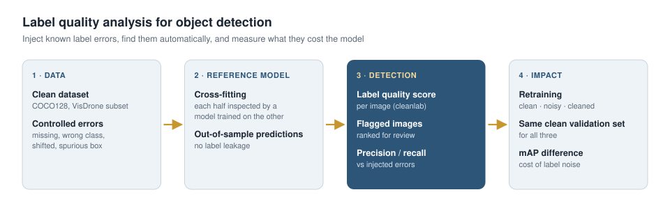

# Label Quality Analysis for Object Detection Datasets

**Automatic detection of wrong, missing and inconsistent labels** in object detection datasets, and **measurement of how label errors affect model performance**.

<p align="center"></p>

> **Status:** Work in progress. Result tables will be added as experiments are completed.

## Problem

Object detectors are only as reliable as the labels they are trained on. Missing annotations, wrong classes and shifted boxes directly reduce a model's real-world performance. In datasets with thousands of images, finding these errors by hand is not practical.

## Approach

To measure the method objectively, **known errors** are injected into a clean dataset, and the share of those errors that is recovered automatically is measured.

| Step | Method | File |
|---|---|---|
| 1. Controlled error injection | A fraction of images receives one of four error types: missing box, wrong class, shifted box, spurious box | `src/inject_noise.py` |
| 2. Error detection | Compare a reference model's predictions with the labels and compute a per-image label quality score (cleanlab) | `src/find_issues.py` |
| 3. Measuring the method | Compare detected issues with injected errors: precision, recall, recall per error type | `src/find_issues.py` |
| 4. Measuring the impact | Train on clean, noisy and cleaned data and evaluate all models on the same clean validation set | `src/train_compare.py` |


## Data

- **Quick experiment:** COCO128 (downloaded automatically by Ultralytics; 128 images, 80 classes).
- **Main experiment:** A subset of VisDrone-DET. The reference model must not have seen the labels it inspects, so the data is split into two halves and each half is inspected by a model trained on the other.

## Installation

```bash
git clone https://github.com/mahdildarr/label-quality-analysis.git
cd label-quality-analysis
pip install -r requirements.txt
```

The quickest way to run everything is the `notebooks/colab_label_quality.ipynb` notebook on Google Colab (GPU enabled).

## Usage

```bash
# 1) Inject controlled errors into 20% of the clean images
python src/inject_noise.py --data coco128.yaml --rate 0.2 --out data/noisy

# 2) Find the errors and measure the method
python src/find_issues.py --images data/noisy/images/train --weights yolo11m.pt \
    --manifest data/noisy/manifest.json --save-vis 8

# 3) Clean / noisy / cleaned training comparison
python src/train_compare.py --data coco128.yaml --noisy data/noisy \
    --report runs/label_quality/report.csv --epochs 30
```

## Evaluation metrics

- **Error detection:** Precision, recall, Precision@k (k = number of corrupted images), recall per error type
- **Model impact:** mAP@0.5 and mAP@0.5:0.95 for the three training scenarios

## Results

| Error type | Recall |
|---|---|
| Missing box | _TBD_ |
| Wrong class | _TBD_ |
| Shifted box | _TBD_ |
| Spurious box | _TBD_ |

| Training data | mAP@0.5 | mAP@0.5:0.95 |
|---|---|---|
| Clean | _TBD_ | _TBD_ |
| Noisy (20% errors) | _TBD_ | _TBD_ |
| Cleaned | _TBD_ | _TBD_ |

## Roadmap

- [x] Error injection, detection and comparison pipeline
- [ ] Quick experiment on COCO128
- [ ] Two-fold cross experiment on a VisDrone subset
- [ ] Comparison of different error rates (10%, 20%, 40%)

## Project structure

```
├── notebooks/colab_label_quality.ipynb
├── src/
│   ├── inject_noise.py     # controlled label error injection
│   ├── find_issues.py      # error detection with cleanlab and evaluation
│   ├── train_compare.py    # clean / noisy / cleaned training comparison
│   └── utils.py            # IoU, label parsing
└── requirements.txt
```

## References

- Northcutt et al., *Confident Learning: Estimating Uncertainty in Dataset Labels*, JAIR, 2021
- Tkachenko et al., *ObjectLab: Automated Diagnosis of Mislabeled Images in Object Detection Data*, 2023
- [cleanlab](https://github.com/cleanlab/cleanlab) · [Ultralytics YOLO](https://github.com/ultralytics/ultralytics)

## License

MIT
